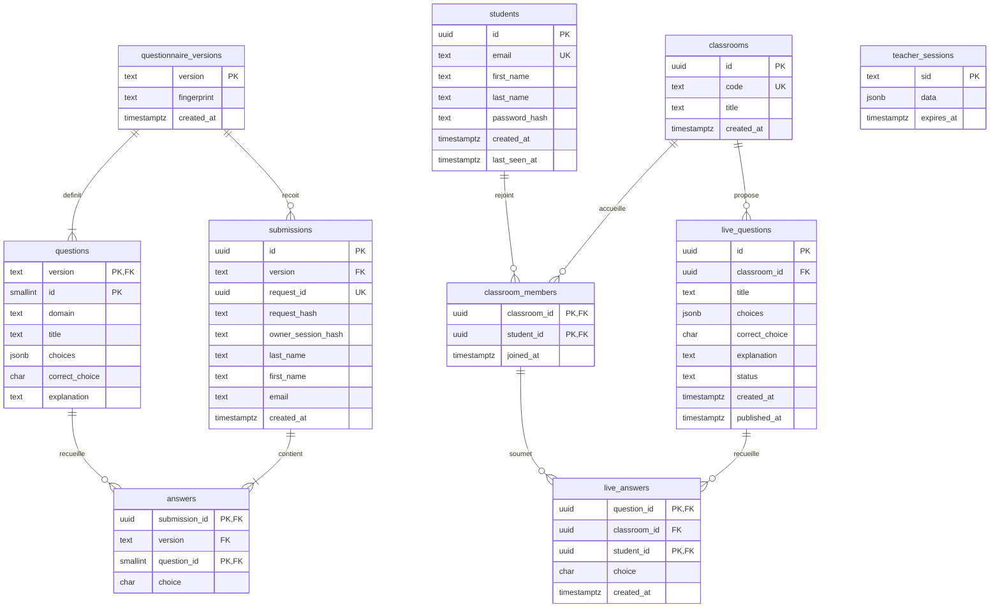

# Diagramme entité-relation — IHME Polytech

Ce diagramme décrit le schéma PostgreSQL réellement utilisé par l’application, après les migrations `001`, `002` et `003`. Le bloc Mermaid s’affiche dans les lecteurs Markdown compatibles, notamment l’aperçu GitHub.

Deux ensembles coexistent : le **bilan historique de 12 questions**, conservé sans modification, et les **séances en direct**, avec comptes étudiants et questions créées par l’enseignant. Toutes les requêtes sont du SQL explicite et paramétré.

## Clés et contraintes

- `PK` : clé primaire ; `FK` : clé étrangère ; `UK` : unicité. Plusieurs attributs `PK` dans une même entité forment une clé primaire composite.
- `questions` : clé `(version, id)` ; identifiants entre 1 et 12. L’empreinte `fingerprint` empêche de modifier silencieusement un questionnaire déjà utilisé.
- `submissions` : unicité de `(version, email)` et de `(id, version)`. Le couple `request_id` / `request_hash`, associé à `owner_session_hash`, permet de réessayer un même envoi sans doublon ni accès au corrigé d’une autre session.
- `answers` : clé `(submission_id, question_id)` ; références composites `(submission_id, version)` vers `submissions` et `(version, question_id)` vers `questions`. La version des réponses doit donc correspondre à celle de la soumission.
- `students` : e-mail normalisé en minuscules, unique ; mot de passe haché avec scrypt et sel aléatoire. Aucun mot de passe en clair n’est stocké.
- `classroom_members` : clé `(classroom_id, student_id)` ; un étudiant rejoint chaque séance une seule fois et peut rejoindre plusieurs séances.
- `live_questions` : unicité supplémentaire `(id, classroom_id)` ; trois choix en JSON, bonne réponse parmi `A`, `B`, `C`. États `draft` → `open` → `closed`. Un index unique partiel interdit plusieurs questions ouvertes simultanément dans une même séance.
- `live_answers` : clé `(question_id, student_id)` ; référence composite `(question_id, classroom_id)` vers `live_questions` et `(classroom_id, student_id)` vers `classroom_members`. Impossible d’associer une réponse à la mauvaise séance ou à un étudiant non inscrit.
- Dans les deux types de questionnaires, `D` représente « Je ne sais pas ». Une réponse en direct devient définitive après son enregistrement ; un réessai identique reste possible.

Les cardinalités « une ou plusieurs réponses » du bilan correspondent au fonctionnement applicatif : les 12 réponses sont insérées avec la soumission dans une transaction. Les clés étrangères seules n’imposent pas ce nombre.

## Sessions et identité

Le nom historique `teacher_sessions` est conservé pour éviter de casser les sessions existantes. Cette table stocke désormais les sessions navigateur enseignantes **et** étudiantes, avec expiration glissante de huit heures. `data` peut contenir `teacher`, `studentId` et le jeton CSRF. Il n’y a pas de clé étrangère SQL dans ce JSON : l’existence du compte étudiant est contrôlée lors de chaque accès protégé.

Le compte enseignant reste configuré par variables d’environnement ; il n’existe pas de table `teachers`. Toutes les séances relèvent du même espace enseignant.

Le bilan historique n’est pas rattaché automatiquement à `students` : il accepte toujours les trois coordonnées déclaratives, sans compte. Une adresse identique n’est pas une preuve d’identité et n’autorise donc pas la récupération de ces anciens corrigés lors de la création d’un compte.

La reconnexion aux séances se fait par e-mail **et mot de passe choisi sur cette application**. Aucun e-mail de validation n’est envoyé : l’appartenance réelle à la boîte universitaire n’est pas vérifiée. La réinitialisation par e-mail n’est pas encore proposée. Ces limites sont à prendre en compte avant toute utilisation pour une évaluation notée.

## Confidentialité et conservation

- Les énoncés et choix publiés sont accessibles uniquement aux étudiants inscrits à la séance ; les brouillons restent réservés à l’enseignant.
- Une bonne réponse et son explication ne sont transmises à un étudiant qu’après l’enregistrement transactionnel de **sa propre réponse**. Les corrigés restent consultables après reconnexion tant que les données sont conservées.
- Les résultats agrégés des séances sont protégés par l’authentification enseignante. Aucun score individuel n’est actuellement calculé.
- `RETENTION_DAYS`, 90 jours par défaut, règle la purge au démarrage et toutes les heures : soumissions et réponses du bilan âgées, réponses en direct âgées, comptes sans connexion/consultation de profil récente et séances âgées.
- La suppression d’une soumission supprime ses réponses ; celle d’un compte supprime ses inscriptions et leurs réponses ; celle d’une séance supprime ses inscriptions, questions et réponses, grâce aux cascades SQL.
- Les questions et versions du bilan restent présentes après la purge des soumissions. Les sessions expirées sont supprimées séparément.

## Sources du schéma

- [Schéma du bilan et sessions](../backend/sql/001_initial.sql)
- [Simplification du profil](../backend/sql/002_simplified_profile.sql)
- [Comptes et séances en direct](../backend/sql/003_live_classrooms.sql)
- [Initialisation et purge](../backend/src/database.js)
- [API et SQL des séances](../backend/src/classrooms.js)
